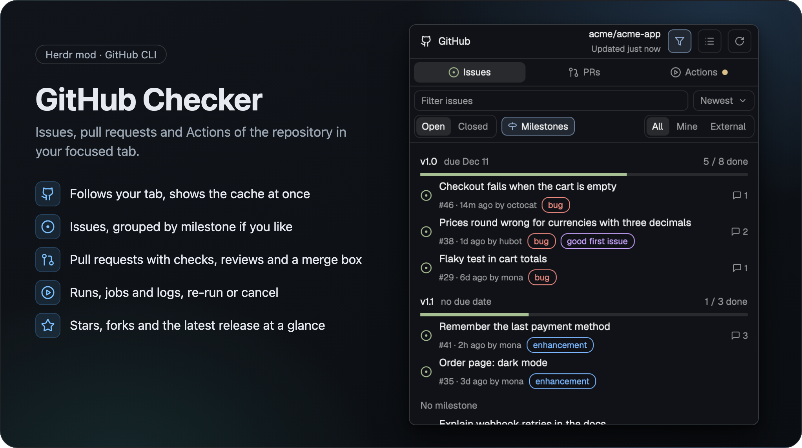
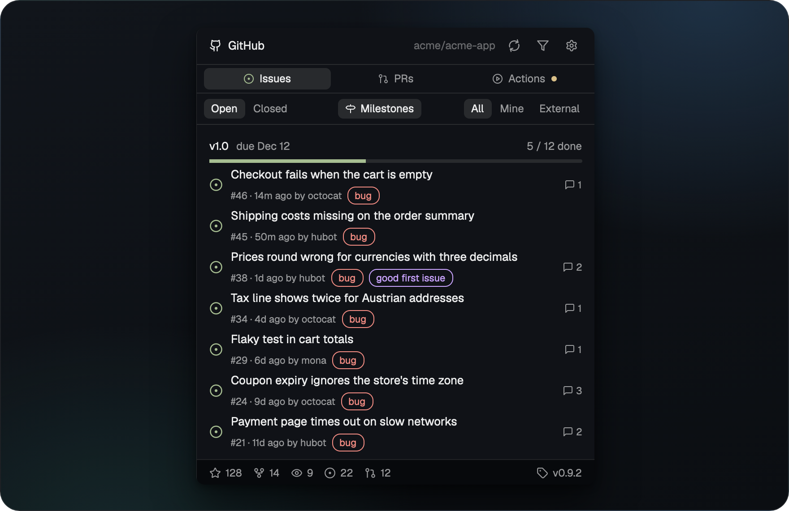
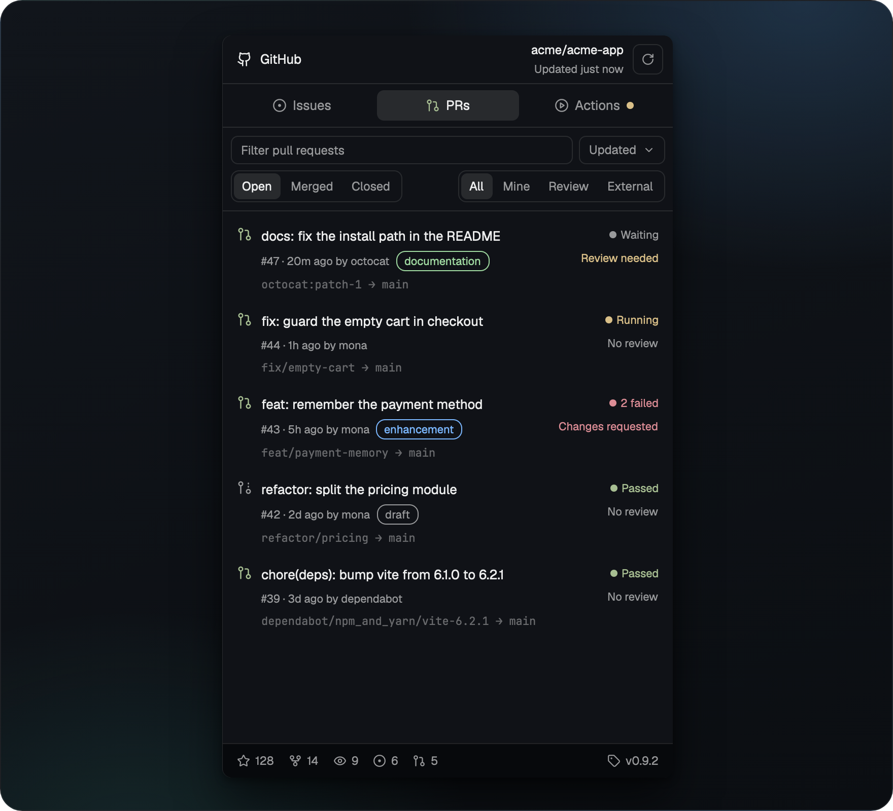
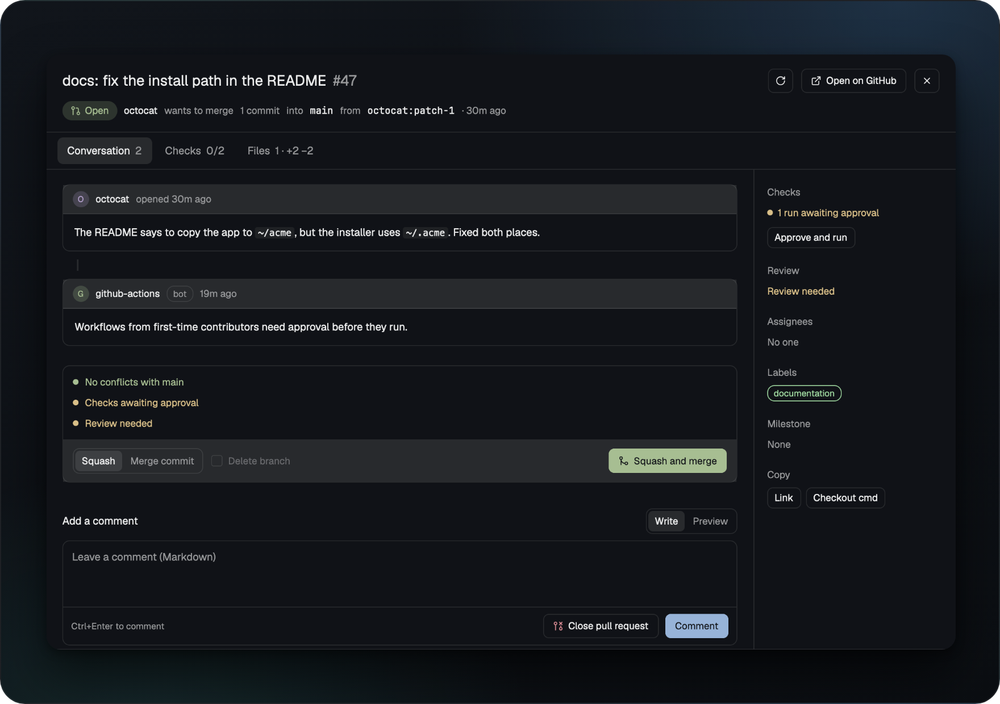
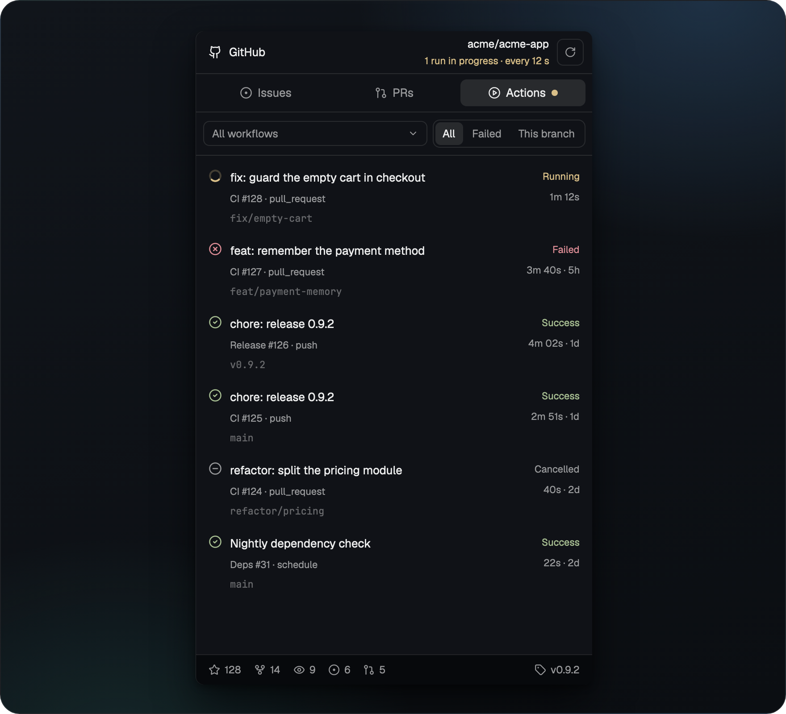
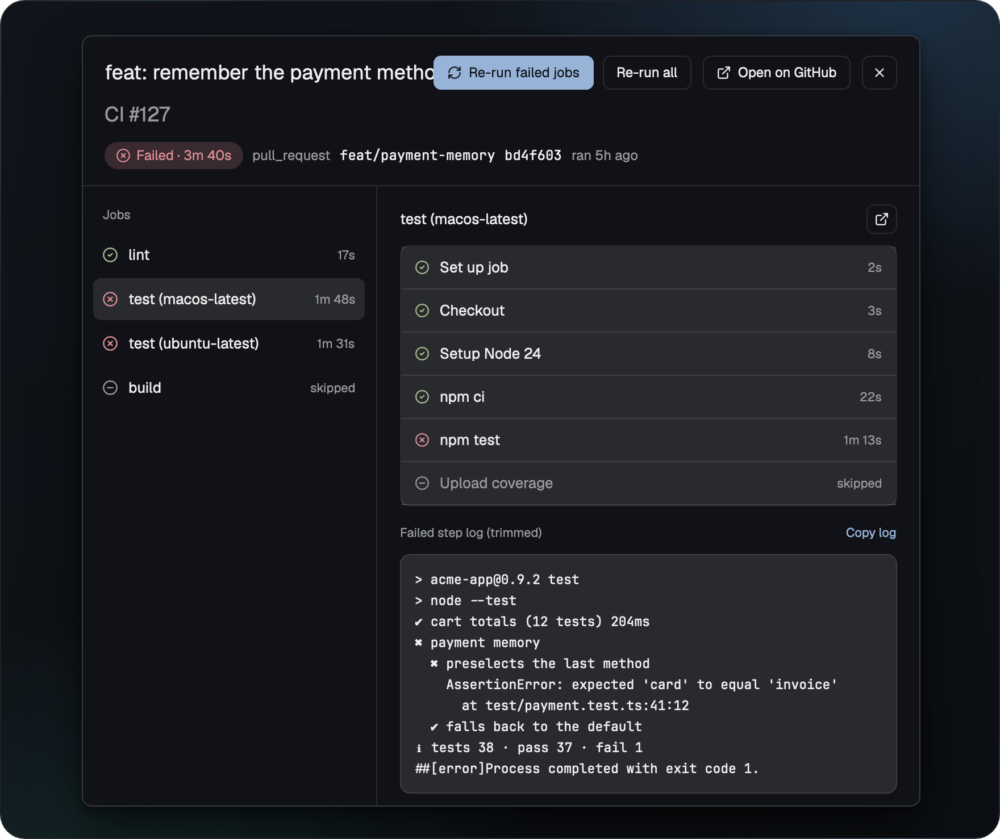

# GitHub Checker



**A slim GitHub panel for the [Herdr app](https://herdr.dev): it follows the focused tab and shows that repository's issues, pull requests and Actions runs.**

- **Follows your tab:** switch tabs and the panel shows that repository at once, from its cache, while it syncs in the background.
- **Issues:** open or closed, all, yours or external, and grouped by milestone with each milestone's progress.
- **Pull requests:** state, branch, checks and review at a glance, and a merge box that offers only what the repository allows.
- **Actions:** runs with status, workflow, trigger, branch and time; jobs, steps and the failure log; re-run or cancel.
- **At a glance:** stars, forks, watchers, open issues and pull requests, and the latest release in the status bar.
- **Quiet:** syncs only while the panel is shown, every 60 s, every 12 s while a run is in progress.

<br>

<p align="center"><a href="https://www.buymeacoffee.com/michaelmayer"></a></p>

<br>

## Install

In Herdr, ask your agent:

```text
Read ~/.config/herdr-app/AGENTS.md, then add this mod: https://github.com/Srv-02/herdr-ghchecker/tree/main
```

Then click `GitHub` in the tab bar.

- **Needs** Herdr on macOS and the [GitHub CLI](https://cli.github.com), signed in (`gh auth login`).
- **By hand, removing, keys:** see the [guide](docs/GUIDE.md#install).

## Features

### Issues

- **Open or Closed**, **All, Mine or External** (opened by someone else, bots left out), sorted by Newest, Oldest or Updated.
- **Milestones:** one switch groups the list by milestone, each with its due date and progress (`5 / 8 done`); issues without one come last.
- **Filter** by title, number, author or label.



### Pull requests

- **Open, Merged or Closed**, **All, Mine, Review** (waiting for your review) **or External**.
- **Each row:** state, branch into base, checks (`2 failed`, `Running`, `Passed`) and the review decision.



### Pull request overlay

- **Conversation** with pictures and events, **Checks** and **Files** in their own sections; comment, close or reopen.
- **Approve and run** for workflow runs of first-time contributors and forks, with a second click to confirm.
- **Merge box:** conflicts, checks and review in one place, only the merge methods the repository allows, Delete branch, and a second click to confirm. Locked for drafts, conflicts and failed checks.



### Actions

- **All, Failed or This branch** (the branch of your terminal), and one workflow or all.
- **The tab's dot:** yellow while a run is in progress, red when the latest run on the default branch failed.
- **Run overlay:** jobs on the left, steps and the trimmed failure log on the right; **Re-run failed jobs**, **Re-run all**, or **Cancel run** while it runs.





### And

- **The repository name** in the header opens it on GitHub.
- **Remote terminals:** a tab on an SSH machine shows the repository of its folder there.
- **No repository here:** a tab outside a GitHub repository shows an empty panel, never the last repository.

## Documentation

- **[Guide](docs/GUIDE.md):** every feature, setting and key in detail, and what it runs.
- **[Development](docs/GUIDE.md#development):** tests, lint and screenshots.

## Credits

- Built on [herdr-github](https://github.com/alarboulletmarin/herdr-github) by alarboulletmarin (MIT): the GitHub calls, the overlays and the timeline.
- The panel and its tab bar button follow [herdr-issues](https://github.com/jankeesvw/herdr-issues) by Jankees van Woezik (MIT).
- Icons from [Lucide](https://lucide.dev) (ISC).

Details in [THIRD_PARTY_NOTICES.md](THIRD_PARTY_NOTICES.md). GitHub Checker is not affiliated with GitHub, Inc.

## License

MIT, see [LICENSE](LICENSE). Third party parts keep their own licenses.
