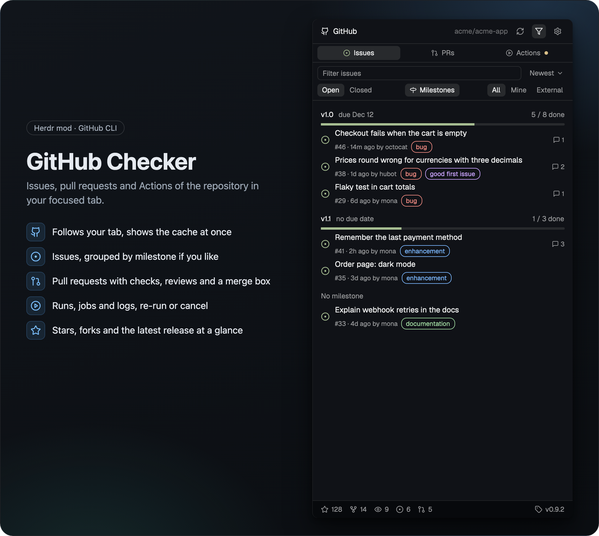

# GitHub Checker

A slim GitHub panel in the right panel column, opened from a `GitHub` pill at the right end of the tab bar. It follows the focused tab: for the GitHub repository of the focused terminal's folder (on this Mac or on an SSH machine) it shows the open issues, pull requests and Actions runs in three tabs, from a cache at once and synced in the background. A click opens a large overlay: an issue or pull request with its conversation (comment, close, reopen; for a pull request also its checks, its files, **Approve and run** and a merge box), or a run with its jobs, steps and log (re-run, cancel). Everything goes through the GitHub CLI `gh`.

## What you see

All colors are `theme()` tokens (states use `ansi1` red, `ansi2` green, `ansi3` yellow, `ansi4` blue, `ansi5` magenta, `muted`, `dim`), so the mod follows the person's theme. Label chips keep their GitHub color unless `labels.color` is `mono`.

**Tab bar pill** (block `ghchecker-button`, 92px wide, at the right of the 42px row `tab-bar` beside the `tabs` block): fills the block, `bg(t.chrome)`, `border_b(1)`, content right-aligned with `pr(10)`; the pill 26px high, `px(8)`, gap 5, radius 6, text 12, a 14px `github.svg` and `GitHub`; `bg(t.selected)` and `t.foreground` while the panel shows it, else `t.muted`; hover `bg(t.hover)`.

**Panel** (block `ghchecker` in `panel` > `panel-body`; the root `rounded(10)`, `border_1()`, `bg(t.background)`, text 13), top to bottom:

1. **Header**, 42px, `px(14)`, gap 8, `border_b(1)`, as Filer Pro's: `github.svg` 14px and `GitHub` semibold; right-aligned the repository `owner/name` in text 12 `t.dim` (truncated; a link to `https://github.com/<owner>/<name>`, underlined on hover, tooltip `Open on GitHub`), or the folder (`~/…`) when it has no GitHub remote. Then 24px icon buttons, 14px glyph, radius 6, no border, hover `bg(t.hover)`, `bg(t.selected)` and `t.foreground` while on: **Refresh** (Filer Pro's `refresh.svg`, turns while a sync runs; `t.ansi1` with a 5px red dot when the last sync failed, the reason and the last update in its tooltip), **Search and sort** (`filter.svg`; a grey dot when a hidden search or sort is set; on Actions it changes nothing), **Settings** (`settings.svg`, always; while a newer release is out gold `#f0c85a` with a gold background at 10 %, a 6px gold dot top right and a gold layer that breathes with `loop("opacity", { from: 0.15, to: 1, period: 2400 })`, tooltip `<version> available`). No status text.
2. **Tabs**, a 32px row, `px(8)`, gap 2: `Issues`, `PRs`, `Actions`, each a third (`flex_1`), centered, 24px high, radius 6, text 12, a 12px icon; the shown one `bg(t.selected)` (the Issues/PRs icon in green). Actions carries a 6px dot: yellow while a run is queued or in progress, red when the newest finished run on the default branch failed.
3. **Filter bar**, `px(8)` `py(6)`, gap 6. While Search and sort is on, first a row with a 24px text field (`Filter issues` / `Filter pull requests`, border `t.border`) and the sort menu (`Newest`, `Oldest`, `Updated`; a popup of this mod). Then always: Issues `Open | Closed`, `Milestones` (a toggle centered between the groups: group by milestone), `All | Mine | External`; PRs `Open | Merged | Closed` and `All | Mine | Review | External`; Actions the workflow menu (`All workflows`) and `All | Failed | This branch`. Segmented items 22px, `px(8)`, radius 6, text 12, the chosen one `bg(t.selected)` `t.foreground`, no border.
4. **List**, a virtual list (`v_virtual_list` with `Scrollbar.vertical`): rows of fixed height, 46px with two lines (title truncated; then `#46 · 14m ago by octocat` and labels, or for a PR `head → base` in mono), 28px with one line in compact mode (`#46` in a 42px column and the title). Right column: comment count (issues), checks dot and word (`2 failed`, `Running`, `Waiting`, `Passed`, `No checks`) and the review (`Approved`, `Changes requested`, `Review needed`, `No review`) for PRs, state word and `3m 40s · 5h` for runs. With Milestones on, a heading per milestone (`v1.0  due Dec 12 … 5 / 8 done` and a 4px progress bar in green), `No milestone` last. Empty states in text 12 `t.dim`.
5. **Status bar**, 30px, `border_t(1)`, `bg(t.chrome)`, text 11.5 `t.muted`, icons 13px: stars, forks, watchers, open issues, open PRs (the last two jump to their tab with Open), right-aligned the latest release tag; an entry without a value is left out.

Without a GitHub repository: the header with the folder, then `No repository in this folder` and `This tab's terminal is in a folder without a GitHub remote. Switch to a tab inside a repository.`; no status bar.

**Overlays** (copies of this mod with props):

- **Issue / pull request** (`{ item }`, dialog 0.88 × 0.9): a top with the title, `#n`, Refresh, `Open on GitHub`, Close; a state pill (`Open` green, `Draft` grey, `Merged` magenta, `Closed` red/magenta) and the byline (`octocat wants to merge 1 commit into main from octocat:patch-1 · 20m ago`). PRs have sections `Conversation 2 | Checks 0/2 | Files 1 · +2 −2`. The conversation: cards for the opening post, comments and reviews (avatar or initial, `bot`, `Owner`, `Author` badges, Markdown with pictures from GitHub hosts only), events as one line each with an icon, a rail between them; for an open PR the merge box; then `Add a comment` (Write/Preview, `Close issue` / `Close pull request`, not planned, `Reopen`, `Comment`, Ctrl+Enter). A 250px right column: Checks (or `1 run awaiting approval` with **Approve and run**), Review, Assignees, Labels, Milestone, Closes/Development, Copy (`Link`, `Checkout cmd` / `Reference`).
- **Merge box** (open PR): lines for conflicts (`No conflicts with main`), checks and review; a bar with only the allowed methods (`Squash | Merge commit | Rebase`), `Delete branch` (preset from the repository, impossible for a fork) and the merge button in green; locked for drafts, conflicts and failed checks with the reason; the first click asks (`Squash and merge #47 into main?`, `Cancel`, `Confirm merge`).
- **Run** (`{ run }`, dialog 0.86 × 0.88): title, `CI #127`, `Re-run failed jobs` (accent) and `Re-run all` when finished, `Cancel run` (then `Confirm cancel` / `Keep running`) while running, `Open on GitHub`, Close; pill `Failed · 3m 40s`, event, branch, short sha, age. A 260px job list on the left (the failed, else running, job picked first), the job's steps on the right, then `Failed step log (trimmed)` with `Copy log`, or `Last log lines`, or `The log shows up here when this job has finished.`.
- **Settings** (`{ settings: true }`, modal dialog 620 × 0.9): Filer Pro's settings layout. `GitHub Checker Settings` (17, medium) with an `Esc` badge; sections in capitals 12.5 `t.muted`: UPDATES (while a newer release is out first a gold box, border and text `#f0c85a`: `GitHub Checker 1.1.0 is available`, `Release notes`, `You have 1.0.0. To update, ask your agent in Herdr:`, the line `Update this mod: https://github.com/Srv-02/herdr-ghchecker/tree/main` in mono with a gold `Copy`; then the row `GitHub Checker 1.0.0` with `You’re up to date. Last checked today at 09:41.` and `Check now`; the switch `Check for updates automatically`), LIST (`Compact rows`, `Show labels`, `Label colors` Color | Mono, dimmed while labels are hidden), EXTERNAL FILTER (`Count bots as external`, `Never external` with a 200px field `octocat, hubot`); footer `GitHub Checker is free and open source.`, `GitHub`, `Buy me a coffee`; at the bottom `Cancel` and `Save` (`t.solid`). Switches 42 × 24, knob 18, `t.accent` when on. Save writes the changed keys only.
- **Menus** (`{ menu }`, popups): sort and workflow, 220px wide, 28px rows with a check at the current one; the pick goes back through shared `ghchecker.pick`.

## How it behaves

- **Location** (`lib/location.js`): the focused pane's `cwd` and branch, else the space folder; a terminal block `machine/tN` names its machine; a focused mod (pane or block) keeps the last location. `git remote -v` runs in that folder on its machine (`exec(..., { on })`); `origin` on github.com wins, else the first github.com remote. A folder without one shows the empty state, never the last repository; a miss is asked again after 30 s. A 3 s timer notices a `cd`.
- **Sync** (`store.js`, `gh.js`): per repository, parts `issues:open`, `prs:open`, `runs`, `milestones`, `info` (default branch, merge methods) and every 10 minutes `stats`; closed or merged lists only while shown. Memory and `appHome()/data/ghchecker/repo-<owner>__<name>.json` (version 1); a switch shows that at once and syncs when older than 15 s. While the panel is shown and the window visible: a full sync every 60 s, the runs every 12 s while one runs. A failed part keeps its last value.
- **Filters** (`lib/filters.js`): text over number, title, author, labels; Mine = opened by or assigned to you (PRs: opened by you); Review = review requested from you; External = someone else and not a bot (`external.includeBots`, `external.ignoreAuthors`); This branch = the focused terminal's branch.
- **Writes**, only on a click: `gh issue|pr comment|close|reopen`, `gh pr merge <n> -R <repo> --squash|--merge|--rebase [--delete-branch]`, `gh run rerun [--failed]`, `gh run cancel`, `gh api -X POST repos/<repo>/actions/runs/<id>/approve`. Then shared `ghchecker.changed` makes the panel sync.
- **Approve and run** (`lib/approve.js`): the waiting runs of the head commit (`status=action_required`); before the button works, the runners of the repository and its organisation are read; any self-hosted runner locks it; without admin rights it works and says the runners were not checked.
- **Pictures** (`lib/images.js`, `media.js`): only `https` from `github.com` (`/user-attachments/…`, `/<login>.png`) and `*.githubusercontent.com`, checked with `URL`; curl with `--proto =https --proto-redir =https --max-redirs 5 --max-filesize 20M`; the gh token only for github.com, on stdin. Anything else: `Image from <host> · open it`.
- **Settings** (`lib/settings.js`): one schema (key, type, default, label, help) for `update_check`, `compact_rows`, `labels.show`, `labels.color`, `external.includeBots`, `external.ignoreAuthors`; file `appHome()/ghchecker.json`, nested or dotted keys, a wrong value means its default; saved with `writeTextFile` against the text read (never over a broken file), then shared `ghchecker.config`.
- **Update check** (`lib/update.js`, `lib/lease.js`, from Filer Pro): one copy holds shared `ghchecker.lease` (renewed every minute, taken after 3 minutes) and at most hourly runs a pass; a request to `https://api.github.com/repos/Srv-02/herdr-ghchecker/releases/latest` only when the last is 24 h old, the installed version (from `mods/ghchecker/mod.json`) changed or the clock moved back. Result in shared `ghchecker.update` `{ at, local, latest }`.
- **Commands** (`nextCommand`, for keys.json `ghchecker:<command>`): `issues`, `prs`, `actions`, `failed`, `group`, `compact`, `filter`, `settings`, `open` (the first row), `refresh`.

## Built from

Folder `mods/ghchecker/`, `mod.json` `{ "place": "none", "version": "1.0.0" }`.

- **One `View`, roles by props**: none: the panel; `{ button: true }`: the pill (adds `ghchecker` to shared `workspace.panels`); `{ item }`, `{ run }`, `{ settings: true }`, `{ menu }`: the overlays.
- **Layout blocks**: in a row `tab-bar` (42px) `{ "id": "ghchecker-button", "type": "block", "content": { "mod": "ghchecker", "props": { "button": true } }, "size": { "px": 92 }, "window_drag": true }`; in `panel` > `panel-body` `{ "id": "ghchecker", "type": "block", "content": { "mod": "ghchecker" }, "size": { "weight": 1 }, "min": 120 }`. The pill finds the panel by its mod.
- **Files**: `main.js` (panel, pill, menus), `viewer.js`, `run.js`, `settings.js`, `gh.js`, `store.js`, `media.js`, `ui.js`; `lib/` pure logic (`status`, `time`, `milestones`, `merge`, `approve`, `filters`, `location`, `markdown`, `images`, `labels`, `stats`, `settings`, `update`, `lease`, `log`, `timeline`), tested with `node --test`.
- **`herdr` functions**: `exec` (with `on`), `spaces`, `panes`, `focused`, `layout`, `window`, `theme`, `home`, `appHome`, `readTextFile`, `writeTextFile`, `shared`, `setShared`, `props`, `openOverlay`, `closeOverlay`, `notify`, `run`, `nextCommand`, `checking`.
- **Programs**: `gh`, `git`, `curl`, `file`, `open`; `globalThis.fetch` for the update check.
- **Art**: Lucide icons in `icons/` (ISC, `icons/LICENSE`).

## Watch out

- The folder name is load-bearing: icons are `mods/ghchecker/icons/<name>.svg`, the version is read from `mods/ghchecker/mod.json`, overlays open `mod: "ghchecker"`, shared keys are `ghchecker.*`.
- A virtual list's rows take no handlers: clicks come by key through `on_item_click`; hover is a style.
- Herdr draws nothing new in a minimized or fully covered window; the timers skip their work then.
- `exec` stops after 30 s by default; gh calls get 60 s.
- Never interpolate into shell text: repository names pass `slugOf` (`[\w.-]` only) before they reach `gh` arguments or API paths; URLs go to curl as `"$2"`.

## Done when

- `herdr-app check ~/.config/herdr-app/mods/ghchecker` passes and `herdr-app status` shows `"errors": []`.
- The `GitHub` pill opens the panel; a tab inside a clone shows its issues at once; a tab in `~` shows `No repository in this folder`.
- Milestones groups the issues with `5 / 8 done` headings; External hides your own and bots' items.
- A PR from a fork shows `octocat:patch-1 → main`; its overlay offers only the repository's merge methods and asks before merging.
- A running run makes the Actions dot yellow and the list refresh every 12 s; its overlay offers `Cancel run`.
- An issue with a picture from another host shows `Image from <host> · open it` and downloads nothing.
- The gear opens Settings; Compact rows and Save switch the list at once and write `compact_rows` to `ghchecker.json`.
- With shared `ghchecker.update` naming a newer release, the gear is gold and shines; the dialog shows the gold box.
